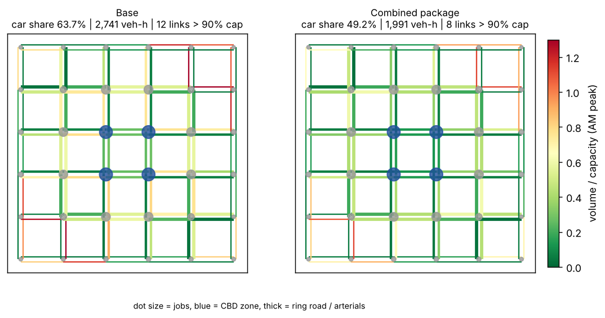
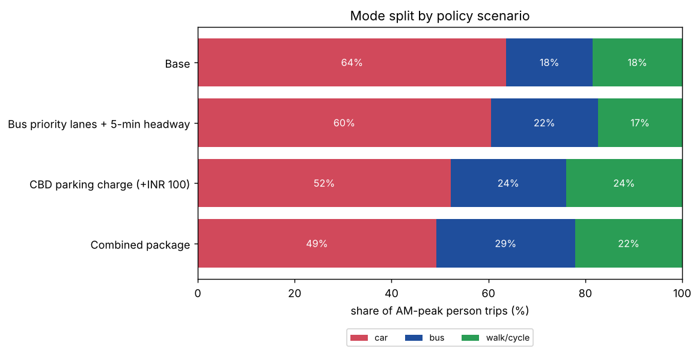
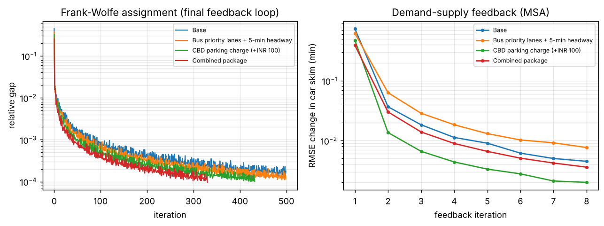

# Urban Transport Four-Step Model


A from-scratch implementation of the **classic four-step travel demand model** (trip generation → distribution → mode choice → traffic assignment). It includes **demand–supply feedback**, so congestion changes where and how people travel. It's used here to test AM-peak congestion policies in a 36-zone synthetic city.

Only NumPy and SciPy are used. Every step is a small, tested function.



## Policy results (AM peak hour, 24,400 person trips)

| Scenario | Car | Bus | Walk/cycle | Vehicle-hours | Vehicle-km | Links > 90% capacity | Car share of trips to CBD |
|---|---:|---:|---:|---:|---:|---:|---:|
| Base | 63.7% | 17.8% | 18.5% | 2,741 | 100,305 | 12 | 59.1% |
| Bus priority lanes + 5-min headway | 60.5% | 22.1% | 17.4% | 2,560 | 95,480 | 11 | 55.3% |
| CBD parking charge (+INR 100) | 52.2% | 23.8% | 24.0% | 2,136 | 79,851 | 10 | 30.0% |
| **Combined package** | **49.2%** | **28.7%** | 22.1% | **1,991** | **75,531** | **8** | **27.1%** |

* **Pricing does more than supply.** The parking charge alone cuts vehicle-hours by 22%, while better buses alone cut them by 7%. Faster buses make transit more attractive, but car trips stay just as cheap.
* **The two policies reinforce each other.** The combined package cuts vehicle-hours by 27% and car share by 14.5 points. Drivers priced out of the CBD find a faster bus to switch to, instead of only walking or travelling to a different destination.
* With feedback, demand also re-distributes: with pricing, the mean trip length drops slightly, as some trips move to destinations outside the CBD.



## Model

| Step | Method |
|---|---|
| **1. Trip generation** | Productions = 0.12 × population, attractions = 0.20 × jobs, attractions balanced to productions |
| **2. Distribution** | Doubly constrained gravity model, `T_ij = a_i b_j P_i A_j exp(−β c_ij)`, balanced with Furness/IPF. β is **calibrated by root-finding** to reproduce an observed mean trip length (3.4 km) in the base year, then held fixed for the policy tests |
| **3. Mode choice** | Multinomial logit over car / bus / walk-cycle, using in-vehicle time, out-of-vehicle time (weighted 2×), fuel, fare and parking. The **logsum** is the composite impedance fed back to distribution |
| **4. Assignment** | Static user equilibrium (Wardrop) with **Frank-Wolfe**, exact line search on the Beckmann objective, BPR volume-delay (α = 0.15, β = 4) |
| **Feedback** | Congested car skims fed back to steps 2–3 and averaged with the **method of successive averages** for 8 iterations |

**Network:** a 6 × 6 grid with 1.5 km spacing and 120 directed links in three classes: ring road (50 km/h, 2,400 veh/h), radial arterials (40 km/h, 1,600 veh/h) and local streets (25 km/h, 600 veh/h). Jobs concentrate in the 4-zone CBD, and population increases toward the edge.



Frank-Wolfe reaches a relative gap of about 1e-4 (its well-known slow tail). The feedback loop settles to a skim change below 0.01 min.

## Verification

The tests check each step against something known independently:

* The gravity model reproduces both trip-end totals, and β calibration hits its target.
* The logit probabilities sum to 1, and the logsum equals the closed form.
* **Frank-Wolfe matches the analytic equilibrium** of a two-route network (equal BPR travel times, solved with Brent's method) at three demand levels, including the case where only one route is used.
* End to end: a parking charge must lower car share.

## Run it

```bash
pip install -e ".[dev]"
python run.py           # all 4 scenarios, about 40 s, writes results/
pytest -q
```

## Layout

```
src/fourstep/
  network.py   grid city, link classes, BPR, shortest paths (scipy dijkstra)
  steps.py     generation, gravity + calibration, logit, AON, Frank-Wolfe
  model.py     scenario definition, feedback loop, metrics
  plot.py      figures
run.py         reproduces the README results
```

## Possible extensions

* Nested logit (car | transit nest) and more modes (two-wheeler, auto-rickshaw, metro)
* Transit assignment with crowding
* Bi-conjugate Frank-Wolfe or path-based (gradient projection) assignment for tighter gaps
* Import a real network and zone system (GTFS + OSM)
